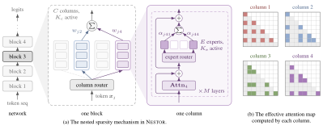

<p align="center"><b>Nested Sparsity for Scalable Pretraining and Continual Learning</b></p>

<p align="center">
  <a href="https://github.com/LeslieTrue">Tianzhe Chu</a>*<sup>1</sup> &middot;
  <a href="https://druvpai.github.io/">Druv Pai</a>*<sup>2</sup> &middot;
  <a href="https://people.eecs.berkeley.edu/~yima/">Yi Ma</a><sup>1,2</sup>
</p>

<p align="center">
  <sup>1</sup>The University of Hong Kong &middot; <sup>2</sup>University of California, Berkeley &middot; *Equal contribution
</p>

<p align="center">
  <a href="https://ma-lab-berkeley.github.io/Nestor/">Project page</a>
</p>

<p align="center">
  
</p>

Nestor is a nested sparse transformer: every layer runs a set of attention
*columns* that each token is routed to a few of, a hybrid expert MLP (a small
public bank plus column-private experts), and a depth read that attends over
the completed blocks. This repository holds the model, the training stack, and
the pretraining and continued-training experiments of the paper.

## Install

```bash
uv sync
uv run nestor_cli --list-experiments   # {dense,moe,nestor}_{100m,200m,500m,1b}
```

## Data

Training reads one flat `.bin` of cl100k token ids, built from a local copy of
DCLM-baseline:

```bash
uv run python scripts/preprocess_dclm.py --dclm-root /data/dclm-baseline-1.0 \
    --out data/dclm/dclm_train.bin --target-tokens 11_000_000_000 --workers 48
uv run python scripts/preprocess_dclm.py --dclm-root /data/dclm-baseline-1.0 \
    --out data/dclm/dclm_val.bin --target-tokens 20_000_000 --global-shards 9
```

Training on the 11B-token corpus above may give slightly different performance
from the paper. Exact reproduction of the paper's data order requires sampling
from the full 105B-token corpus: change the training preprocessing argument to
`--target-tokens 105_000_000_000`, using the same DCLM source shards. The existing
training sampler shuffles windows from that corpus automatically; keep the
training budget and validation preprocessing arguments unchanged.

## Train

On one 8-GPU node:

```bash
DCLM_DATA_PATH=data/dclm/dclm_train.bin sbatch scripts/slurm_pretrain.sh nestor_200m
# or directly
DCLM_DATA_PATH=data/dclm/dclm_train.bin NESTOR_DDP=1 NESTOR_BF16=1 NESTOR_COMPILE=1 \
  uv run torchrun --standalone --nproc_per_node=8 -m nestor.cli --experiment nestor_200m
```

Resubmitting an experiment resumes from its latest checkpoint under
`NESTOR_OUTPUT_ROOT` (default `outputs/`). The experiment definitions are in
`nestor/experiments/pretrain.py`; the continued-training launchers
(long-context extension, domain adaptation) are in `scripts/` and documented
in `nestor/continual/`.

## Evaluate

```bash
uv run python scripts/eval_heldout.py --experiment nestor_200m \
    --checkpoint outputs/nestor_200m/<run>/checkpoints/model_final.pt \
    --val-bin data/dclm/dclm_val.bin
```

## Tests

```bash
uv run pytest tests -q
```

## Citation

```bibtex
@article{chu2026nestor,
  title   = {Nested Sparsity for Scalable Pretraining and Continual Learning},
  author  = {Chu, Tianzhe and Pai, Druv and Ma, Yi},
  year    = {2026},
  note    = {Preprint}
}
```
